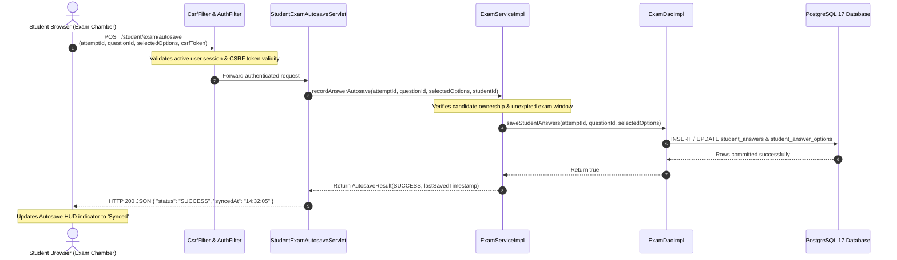

# Academic Project Report — QuizTrack

**Course Title:** Advanced Java Enterprise Application Development  
**Project Title:** QuizTrack — Full-Stack Online Examination & Proctoring Platform  
**Target Platform:** Jakarta EE 10 (Servlet 6.0, JSP 3.1) on Apache Tomcat 10.1+ with PostgreSQL 17  
**Build Tool:** Apache Maven 3.9+  

---

## 1. Introduction & Problem Statement

### Problem Statement Heading
> **Secure Automated Online Examination And Proctoring Platform**

*(Total: Exactly 7 words)*

### Problem Description
Traditional pen-and-paper examinations and legacy web test applications face severe structural challenges in modern academia:
1. **Academic Dishonesty & Compromised Integrity:** Examinees frequently switch browser tabs, search for unauthorized answers, or exit exam environments without instructor detection.
2. **Operational Latency & Paper Overhead:** Manual drafting, printing, distribution, and handwritten grading consume dozens of faculty hours and result in multi-week feedback delays.
3. **Data Loss During Network Disruptions:** Most legacy systems only record answers upon final form submission; an unexpected browser crash, device power loss, or network flicker erases candidate progress.
4. **Disjointed Multi-Role Workflows:** Institutions frequently use fragmented software for quiz authoring, live proctoring, student gradebooks, and administrator governance, leading to data silos.

### Proposed Solution
**QuizTrack** is a centralized, role-based enterprise web platform developed in Java 21 and Jakarta EE 10 that solves these challenges through:
- **Distraction-Free Exam Engine with Strict Fullscreen Lockdown:** The client browser is locked to fullscreen mode using the HTML5 Fullscreen API with active blur/tab-switch event detection, automated warning strikes, and live teacher telemetry.
- **Asynchronous Answer Autosave:** Every selection (Single Choice, Multi-Correct Choice, True/False) is instantly and asynchronously persisted to PostgreSQL via AJAX/Fetch, eliminating progress loss.
- **Integrated 3-Role Governance:** Seamless role segregation across Administrators, Teachers, and Students with dedicated operational workspaces and strict Cross-Site Request Forgery (CSRF) protection.
- **Dynamic Question Builder & Question Bank:** An interactive authoring studio allowing faculty to create multi-type questions, reuse departmental items via join tables, and auto-compute aggregate quiz points.

---

## 2. Project Modules

QuizTrack is divided into three interconnected, role-governed modules:

```
                              ┌──────────────────────────────────┐
                              │            QuizTrack             │
                              │     Institutional Gateway        │
                              └─────────────────┬────────────────┘
                                                │
         ┌──────────────────────────────┬───────┴──────────────────────┬──────────────────────────────┐
         ▼                              ▼                              ▼                              ▼
┌──────────────────┐           ┌──────────────────┐           ┌──────────────────┐           ┌──────────────────┐
│  Authentication  │           │   Admin Module   │           │  Teacher Module  │           │  Student Module  │
│  & CSRF Security │           │(Executive Hub)   │           │(Faculty Studio)  │           │ (Candidate Hub)  │
└──────────────────┘           └──────────────────┘           └──────────────────┘           └──────────────────┘
```

### 2.1 Admin Module (Institutional Governance Hub)
- **Executive System Dashboard:** Real-time visibility into institutional health, total enrolled candidates, faculty rosters, created examinations, and active live sessions.
- **Department & Branch Management:** Aggregated departmental breakdown displaying faculty counts, authored exams, and top 5 student performers per branch.
- **User Provisioning & Directory:** Paginated user administration to create, inspect, edit, activate, or suspend student and faculty accounts.
- **Security & Global Configuration:** Real-time tuning of system parameters (session timeouts, maximum exam duration, self-registration toggle, maintenance mode).
- **Audit Logs:** Immutable audit trail recording administrative and security events with client IP addresses, actor identities, and timestamps.

### 2.2 Teacher Module (Faculty Academic Studio)
- **Academic Overview Dashboard:** Visual KPI hub with active exam status banners, countdown timers, candidate completion averages, and pending grading alerts.
- **Step-by-Step Quiz Creator:** 4-step guided wizard configuring course subjects, scheduling windows (`start_time` and `end_time`), anti-cheat policies, duration limits, and pass thresholds.
- **Dynamic Question Builder:** Interactive interface supporting Single Choice (radios), Multi-Correct Choices (checkboxes with proportional partial credit), and True/False questions.
- **Departmental Question Bank:** Centralized repository enabling reuse of peer-reviewed questions across multiple quizzes without data duplication via join tables.
- **Cohort & Student Assignment:** Department-scoped assignment matrix ensuring faculty can only publish exams to eligible cohorts and students within their academic department.
- **Live Proctoring Command Center:** Real-time examination monitor displaying examinee progress, time elapsed, tab switches, fullscreen violations, and live instructor broadcast messaging.
- **Performance Evaluation & Reports:** Grade distributions, question-level analytics, pass/fail ratios, and CSV enrollment roster exports.

### 2.3 Student Module (Candidate Examination Hub)
- **Student Academic Dashboard:** Enrolled curriculum cards, upcoming and live assessment discovery, hardware pre-flight diagnostic checklists (webcam, microphone, latency), and cumulative scores.
- **Secure Timed Exam Chamber:** Distraction-free exam room with synchronized countdown timers, question palette navigation (Answered, Flagged for Review, Not Visited), and instant autosave.
- **Fullscreen Proctoring Lockdown:** Enforced fullscreen chamber with exit tripwires that log telemetry strikes and report directly to faculty monitors.
- **Instant Itemized Scorecard & Review:** Detailed post-exam performance reports showing earned marks, subject mastery rankings, and answer-level explanations.
- **Cohort Leaderboard & Cryptographic Certificates:** Class percentile standings and tamper-resistant digital completion certificates.

---

## 3. Project Architecture & Request Flow

QuizTrack strictly implements the **Model-View-Controller (MVC)** architectural pattern with clean separation of concerns across presentation, security, business logic, and database access.

### 3.1 High-Level Layered Architecture

```mermaid
flowchart TD
    subgraph PresentationLayer["Presentation Layer (Client Browser)"]
        UI1["Admin Executive Console"]
        UI2["Teacher Faculty Hub"]
        UI3["Student Exam Chamber"]
    end

    subgraph FilterChain["Security & Middleware Filter Chain"]
        F1["CharacterEncodingFilter (UTF-8)"]
        F2["NoCacheFilter (Browser Cache Control)"]
        F3["AuthenticationFilter (Session Guard)"]
        F4["RoleAuthorizationFilter (RBAC)"]
        F5["CsrfFilter (Anti-CSRF Token Guard)"]
    end

    subgraph ControllerLayer["Web Controller Layer (Jakarta Servlets)"]
        C1["Admin Servlets"]
        C2["Teacher & Proctor Servlets"]
        C3["Student & Exam Servlets"]
    end

    subgraph ServiceLayer["Business Logic Layer (Services)"]
        S1["AdminServiceImpl"]
        S2["TeacherServiceImpl & ProctorServiceImpl"]
        S3["StudentServiceImpl & ExamServiceImpl"]
    end

    subgraph PersistenceLayer["Data Access Layer (JDBC DAOs)"]
        D1["AdminDao / UserDao"]
        D2["QuizDao / QuestionDao / QuizAssignmentDao"]
        D3["ExamDao / StudentDao / ResultDao"]
    end

    subgraph StorageLayer["Database Storage"]
        DB[("PostgreSQL 17 Database Engine")]
    end

    PresentationLayer --> FilterChain
    FilterChain --> ControllerLayer
    ControllerLayer --> ServiceLayer
    ServiceLayer --> PersistenceLayer
    PersistenceLayer --> StorageLayer
```


### 3.2 Single API Call Flow: Examinee Answer Autosave
Below is the execution sequence when a student selects an option in the exam room:



---

## 4. Top 5 Features & Source Code Implementation

The platform focuses on 5 core features spanning administration, instruction, proctoring, and test taking.

```
┌────────────────────────────────────────────────────────────────────────────────────────┐
│                                 QUIZTRACK TOP 5 FEATURES                               │
├──────────────────────────┬─────────────────────────────────────────────────────────────┤
│ 1. Admin Dashboard       │ Executive overview, KPI cards, and department management    │
│ 2. Teacher Dashboard     │ Faculty academic hub, live exam status, and quick actions   │
│ 3. Student Dashboard     │ Enrolled exams, scheduled assessments, and hardware check   │
│ 4. Fullscreen Lockdown   │ Secure exam chamber, fullscreen enforcement, and autosave   │
│ 5. Teacher Quiz Creation │ 4-step wizard, question builder, and parameter validation   │
└──────────────────────────┴─────────────────────────────────────────────────────────────┘
```

---

### Feature 1: Admin Executive Dashboard & Department Management
* **Role:** Administrator
* **Source Files:**
  - Controller: `src/main/java/com/quiztrack/controller/admin/AdminDashboardServlet.java`
  - Service: `src/main/java/com/quiztrack/service/impl/AdminServiceImpl.java`
  - DAO: `src/main/java/com/quiztrack/dao/impl/AdminDaoImpl.java`
  - View: `src/main/webapp/WEB-INF/views/admin/dashboard.jsp`
* **Functionality:** Aggregates system metrics (student and faculty counts, active exams, completion rates) and compiles departmental summaries including authored quizzes and top student performers.

#### Core Source Code Snippet (`AdminDaoImpl.java`):
```java
public AdminDashboardStats getDashboardStatistics() {
    AdminDashboardStats stats = new AdminDashboardStats();
    String statsSql = 
        "SELECT " +
        "  (SELECT COUNT(*) FROM users WHERE role_id = (SELECT role_id FROM roles WHERE role_name = 'STUDENT')) AS student_count, " +
        "  (SELECT COUNT(*) FROM users WHERE role_id = (SELECT role_id FROM roles WHERE role_name = 'TEACHER')) AS teacher_count, " +
        "  (SELECT COUNT(*) FROM users WHERE role_id = (SELECT role_id FROM roles WHERE role_name = 'ADMIN')) AS admin_count, " +
        "  (SELECT COUNT(*) FROM quizzes) AS total_quizzes, " +
        "  (SELECT COUNT(*) FROM quizzes WHERE status = 'ACTIVE') AS active_exams, " +
        "  (SELECT COUNT(*) FROM quiz_attempts WHERE status = 'SUBMITTED') AS completed_attempts, " +
        "  (SELECT COALESCE(AVG(percentage), 0.0) FROM quiz_attempts WHERE status = 'SUBMITTED') AS avg_score, " +
        "  (SELECT COALESCE((COUNT(CASE WHEN passed = TRUE THEN 1 END) * 100.0 / NULLIF(COUNT(*), 0)), 0.0) " +
        "   FROM quiz_attempts WHERE status = 'SUBMITTED') AS pass_rate";

    try (Connection conn = DatabaseConnection.getConnection();
         PreparedStatement ps = conn.prepareStatement(statsSql);
         ResultSet rs = ps.executeQuery()) {
        if (rs.next()) {
            stats.setTotalStudents(rs.getInt("student_count"));
            stats.setTotalTeachers(rs.getInt("teacher_count"));
            stats.setTotalAdmins(rs.getInt("admin_count"));
            stats.setTotalQuizzes(rs.getInt("total_quizzes"));
            stats.setActiveExaminations(rs.getInt("active_exams"));
            stats.setCompletedAttempts(rs.getInt("completed_attempts"));
            stats.setAverageScorePercentage(Math.round(rs.getDouble("avg_score") * 100.0) / 100.0);
            stats.setOverallPassRate(Math.round(rs.getDouble("pass_rate") * 100.0) / 100.0);
        }
    } catch (SQLException e) {
        logger.error("Error retrieving admin dashboard metrics", e);
    }
    return stats;
}
```

---

### Feature 2: Teacher Academic Overview Dashboard
* **Role:** Teacher / Faculty
* **Source Files:**
  - Controller: `src/main/java/com/quiztrack/controller/teacher/TeacherDashboardServlet.java`
  - Service: `src/main/java/com/quiztrack/service/impl/TeacherServiceImpl.java`
  - View: `src/main/webapp/WEB-INF/views/teacher/dashboard.jsp`
* **Functionality:** Provides faculty with live status monitoring of authored quizzes, dynamic remaining countdown clocks, live student connection rates, and instant shortcuts to live proctoring.

#### Core Source Code Snippet (`TeacherServiceImpl.java`):
```java
@Override
public TeacherDashboardData getDashboardOverview(int teacherId, boolean isAdmin) {
    TeacherDashboardData data = new TeacherDashboardData();
    data.setActiveQuizzesCount(isAdmin ? quizDao.countQuizzesByStatus("ACTIVE") 
                                       : quizDao.countQuizzesByStatusAndTeacher("ACTIVE", teacherId));
    data.setScheduledQuizzesCount(isAdmin ? quizDao.countQuizzesByStatus("SCHEDULED") 
                                           : quizDao.countQuizzesByStatusAndTeacher("SCHEDULED", teacherId));
    data.setCompletedSessionsCount(analyticsDao.countTotalCompletedSessions());
    data.setAverageClassScore(analyticsDao.calculateAverageClassScore());
    data.setProctorTrustIndex(analyticsDao.getProctorTrustIndex());

    // In-Flight Live Examination Banner with Dynamic Countdown
    Optional<Quiz> activeQuizOpt = isAdmin ? quizDao.findActiveQuiz() 
                                           : quizDao.findActiveQuizByTeacher(teacherId);
    if (activeQuizOpt.isPresent()) {
        Quiz activeQuiz = activeQuizOpt.get();
        data.setActiveQuiz(activeQuiz);
        int examinees = analyticsDao.countActiveExaminees(activeQuiz.getQuizId());
        int totalAssigned = analyticsDao.countTotalAssignedStudents(activeQuiz.getQuizId());
        data.setActiveExaminees(examinees);
        data.setTotalAssignedExaminees(totalAssigned);
        
        int connectedPct = (totalAssigned > 0) ? (int) Math.round(((double) examinees / totalAssigned) * 100.0) : 0;
        data.setConnectedPercentage(Math.min(100, Math.max(0, connectedPct)));
        
        if (activeQuiz.getEndTime() != null) {
            long remainingMillis = activeQuiz.getEndTime().getTime() - System.currentTimeMillis();
            if (remainingMillis > 0) {
                long totalMinutes = remainingMillis / (60 * 1000);
                data.setRemainingTime(String.format("%02dh %02dm remaining", totalMinutes / 60, totalMinutes % 60));
            }
        }
    }
    return data;
}
```

---

### Feature 3: Student Academic Dashboard
* **Role:** Student / Candidate
* **Source Files:**
  - Controller: `src/main/java/com/quiztrack/controller/student/StudentDashboardServlet.java`
  - Service: `src/main/java/com/quiztrack/service/impl/StudentServiceImpl.java`
  - View: `src/main/webapp/WEB-INF/views/student/dashboard.jsp`
* **Functionality:** Discovers assigned quizzes scoped to the student's cohort, displays candidate performance indices (GPA, Integrity Index), and runs client-side hardware pre-flight verifications.

#### Core Source Code Snippet (`StudentServiceImpl.java`):
```java
@Override
public StudentDashboardData getStudentDashboardData(int studentId) {
    StudentDashboardData data = new StudentDashboardData();

    // 1. Fetch Student Profile & Cohort
    Optional<User> userOpt = userDao.findById(studentId);
    userOpt.ifPresent(u -> {
        data.setStudent(u);
        if (u.getCohort() != null && !u.getCohort().isEmpty()) {
            data.setCohortCode("COHORT " + u.getCohort());
        }
    });

    // 2. Load Assigned Quizzes with Start-Window Gating
    List<StudentQuizCard> assignedQuizzes = studentDao.getAssignedQuizzes(studentId);
    data.setAssignedQuizzes(assignedQuizzes);

    // 3. Prioritize Active In-Progress Assessment for Hero Banner
    for (StudentQuizCard card : assignedQuizzes) {
        if ("ACTIVE".equalsIgnoreCase(card.getStatus()) && !"SUBMITTED".equalsIgnoreCase(card.getAttemptStatus())) {
            quizDao.findById(card.getQuizId()).ifPresent(data::setActiveQuiz);
            break;
        }
    }

    // 4. Populate Diagnostic KPIs (Attempts, Standing, GPA, Integrity Index)
    studentDao.populateStudentKPIs(studentId, data);
    return data;
}
```

---

### Feature 4: Live Exam Engine with Fullscreen Proctoring Lockdown
* **Role:** Student Examination Chamber
* **Source Files:**
  - Controllers: 
    - `src/main/java/com/quiztrack/controller/student/StudentExamServlet.java`
    - `src/main/java/com/quiztrack/controller/student/StudentExamAutosaveServlet.java`
  - View: `src/main/webapp/WEB-INF/views/student/exam-engine.jsp`
* **Functionality:** Locks candidate browser into full-screen mode, intercepts `fullscreenchange` and window blur events to log telemetry strikes, and provides instant asynchronous option autosave to PostgreSQL.

#### Core Source Code Snippet (`exam-engine.jsp` & `StudentExamAutosaveServlet.java`):
```javascript
// Client-Side Fullscreen Lockdown Interceptor (exam-engine.jsp)
function triggerFullscreenLockdown() {
    const docEl = document.documentElement;
    const req = docEl.requestFullscreen || docEl.webkitRequestFullscreen || docEl.mozRequestFullScreen;
    if (req) {
        req.call(docEl).then(() => {
            document.getElementById('fullscreen-gate-modal').classList.add('hidden');
        }).catch(err => {
            alert("Fullscreen permission is mandatory to proceed with this assessment.");
        });
    }
}

// Fullscreen Exit Event Listener & Anti-Cheat Strike Logger
document.addEventListener('fullscreenchange', function() {
    if (!document.fullscreenElement) {
        // Examinee exited fullscreen - Trigger security warning strike
        logProctorViolation('FULLSCREEN_EXIT', 'Candidate minimized or exited fullscreen assessment chamber.');
        document.getElementById('fullscreen-gate-modal').classList.remove('hidden');
    }
});

// Asynchronous Answer Autosave
function triggerAutosave(qIndex) {
    const selectedOptions = getSelectedOptionValues(qIndex);
    const payload = new URLSearchParams({
        csrfToken: EXAM_CONTEXT.csrfToken,
        attemptId: EXAM_CONTEXT.attemptId,
        questionId: questions[qIndex].questionId,
        selectedOptions: selectedOptions.join(',')
    });

    fetch(EXAM_CONTEXT.contextPath + '/student/exam/autosave', {
        method: 'POST',
        headers: { 'Content-Type': 'application/x-www-form-urlencoded' },
        body: payload
    }).then(r => r.json()).then(res => {
        if (res.status === 'SUCCESS') {
            document.getElementById('autosave-time').innerText = new Date().toLocaleTimeString();
        }
    });
}
```

```java
// Server-Side Autosave Processing (StudentExamAutosaveServlet.java)
@Override
protected void doPost(HttpServletRequest request, HttpServletResponse response) 
        throws ServletException, IOException {
    response.setContentType("application/json");
    int attemptId = Integer.parseInt(request.getParameter("attemptId"));
    int questionId = Integer.parseInt(request.getParameter("questionId"));
    String[] optionIds = request.getParameterValues("selectedOptions");
    int studentId = (Integer) request.getSession().getAttribute("userId");

    boolean saved = examService.recordAnswerAutosave(attemptId, questionId, optionIds, studentId);
    JsonObject json = new JsonObject();
    json.addProperty("status", saved ? "SUCCESS" : "ERROR");
    json.addProperty("timestamp", System.currentTimeMillis());
    response.getWriter().write(json.toString());
}
```

---

### Feature 5: Teacher Quiz Creation & Question Builder Flow
* **Role:** Teacher / Faculty
* **Source Files:**
  - Controllers:
    - `src/main/java/com/quiztrack/controller/teacher/TeacherQuizCreateServlet.java`
    - `src/main/java/com/quiztrack/controller/teacher/TeacherQuizBuilderServlet.java`
  - Service: `src/main/java/com/quiztrack/service/impl/TeacherServiceImpl.java`
  - View: `src/main/webapp/WEB-INF/views/teacher/quiz-create.jsp`
* **Functionality:** 4-step wizard validating examination parameters (title, course, duration, start/end windows, anti-cheat locks) and adding questions (MCQ, Multi-Correct with partial credit, True/False) with auto-computed total marks.

#### Core Source Code Snippet (`TeacherQuizCreateServlet.java` & `TeacherServiceImpl.java`):
```java
// Parameter Validation & Quiz Creation (TeacherQuizCreateServlet.java)
protected void doPost(HttpServletRequest request, HttpServletResponse response) 
        throws ServletException, IOException {
    int teacherId = (Integer) request.getSession().getAttribute("userId");
    String title = request.getParameter("title");
    int subjectId = Integer.parseInt(request.getParameter("subjectId"));
    int durationMinutes = Integer.parseInt(request.getParameter("durationMinutes"));
    String startTimeStr = request.getParameter("startTime");
    String endTimeStr = request.getParameter("endTime");

    // Service validation ensures start_time < end_time and duration fits window
    teacherService.validateQuizParameters(title, durationMinutes, startTimeStr, endTimeStr);

    Quiz quiz = new Quiz();
    quiz.setTitle(title.trim());
    quiz.setTeacherId(teacherId);
    quiz.setSubjectId(subjectId);
    quiz.setDurationMinutes(durationMinutes);
    quiz.setStartTime(parseTimestamp(startTimeStr));
    quiz.setEndTime(parseTimestamp(endTimeStr));
    quiz.setStatus("DRAFT"); // Initial status restricted to DRAFT or SCHEDULED

    int quizId = teacherService.createQuiz(quiz);
    response.sendRedirect(request.getContextPath() + "/teacher/quiz/builder?quizId=" + quizId);
}
```

---

## 5. Output Screenshots & Step-by-Step Navigation

All project screenshots are organized in the [`docs/screenshots/`](file:///E:/QuizTrack/docs/screenshots) directory of the repository.

```
docs/screenshots/
├── 01_admin_dashboard.jpg         # Feature 1: Admin Executive Dashboard
├── 02_teacher_dashboard.jpg       # Feature 2: Teacher Academic Overview & Live Session
├── 03_student_dashboard.jpg       # Feature 3: Student Examination Dashboard
├── 04_exam_engine.png             # Feature 4: Live Exam Engine & Question Palette
├── 05_teacher_quiz_creation.jpg   # Feature 5: Teacher Quiz Builder & Question Drafting
├── 06_code_admin_dao.jpg          # Code Capture: AdminDaoImpl.java in VS Code
└── 07_code_teacher_service.jpg    # Code Capture: TeacherServiceImpl.java in VS Code
```

### Screenshot Details & How to Reproduce

| # | Feature Name | Image File in `docs/screenshots/` | How to Navigate in Browser / IDE | Key Elements Displayed |
|---|---|---|---|---|
| **1** | **Admin Executive Dashboard** | `01_admin_dashboard.jpg` | 1. Navigate to: `http://localhost:8080/quiztrack/auth/demo?role=admin`<br/>2. Click **Executive Overview** on the sidebar. | • Executive System Console with "System Operational" badge<br/>• 6 KPI cards (35 Enrolled Students, 4 Instructors, 1 Admin, 8 Quizzes, 2 Active Exams, 5 Certified Submissions)<br/>• Institutional Examination Performance (76.6% Avg Score, 80.0% Pass Rate)<br/>• Real-time Live System Audit stream |
| **2** | **Teacher Academic Dashboard** | `02_teacher_dashboard.jpg` | 1. Navigate to: `http://localhost:8080/quiztrack/auth/demo?role=teacher`<br/>2. View the **Academic Overview** workspace. | • Active CS402 Midterm Exam session banner with 42/6 (100% Connected) stream status<br/>• AI Sentinel flag alerts (3 Review Pending)<br/>• 5 Faculty KPI cards (35 Students, 2 Active Quizzes, 5 Sessions, 76.6% Average, 90.0% Trust Index) |
| **3** | **Student Examination Dashboard** | `03_student_dashboard.jpg` | 1. Navigate to: `http://localhost:8080/quiztrack/auth/demo?role=student`<br/>2. View the candidate overview workspace. | • "Welcome back, Alex!" with Live Exam Portal countdown<br/>• 4 KPIs: 1/4 Quizzes Attempted, 84.3% Cumulative Score (Grade B+), 94.2th Percentile Cohort Standing, 99.1% Integrity Index<br/>• Hardware Pre-Flight checks (Camera, Microphone, Lockdown API, Latency) |
| **4** | **Live Exam Engine & Fullscreen Lock** | `04_exam_engine.png` | 1. Log in as Student (`/auth/demo?role=student`).<br/>2. Click **Start Assessment** on an active quiz card. | • Live countdown timer (19:42 remaining) and synchronized status<br/>• Question 1 (Single Choice) with 4 choice options and active selection indicator<br/>• Question Palette showing Answered, Review, and Current Focus states<br/>• Cryptographic session lock notification |
| **5** | **Teacher Quiz Builder Studio** | `05_teacher_quiz_creation.jpg` | 1. Log in as Teacher (`/auth/demo?role=teacher`).<br/>2. Open Quiz Builder (`/teacher/quiz/builder?quizId=...`). | • Question #1 authoring workspace with MCQ Single, Multi-Correct, and True/False pill toggles<br/>• Point weight (4.00), Cognitive Depth (Medium Application), and Topic Tag<br/>• KaTeX formula & Markdown formatting toolbar<br/>• Dynamic option slots with radio selector |
| **6** | **Admin DAO Source Code** | `06_code_admin_dao.jpg` | Open VS Code at:<br/>`src/main/java/com/quiztrack/dao/impl/AdminDaoImpl.java` | • VS Code workspace showing file tree and `AdminDaoImpl.java`<br/>• `getDashboardStatistics()` method compiling multi-table PostgreSQL metrics |
| **7** | **Teacher Service Source Code** | `07_code_teacher_service.jpg` | Open VS Code at:<br/>`src/main/java/com/quiztrack/service/impl/TeacherServiceImpl.java` | • VS Code workspace showing file tree and `TeacherServiceImpl.java`<br/>• Dependency injection constructors for DAOs (`QuizDao`, `QuestionDao`, `AnalyticsDao`, etc.) |

---

## 6. Project Directory Map (Where Code Files are Located)

When presenting code to your teacher or instructor, navigate to the following file locations:

```
QuizTrack/
├── src/main/java/com/quiztrack/
│   ├── controller/
│   │   ├── admin/
│   │   │   ├── AdminDashboardServlet.java       # Feature 1: Admin dashboard servlet
│   │   │   ├── AdminDepartmentServlet.java      # Feature 1: Department summaries
│   │   │   └── AdminUsersServlet.java           # Feature 1: User provisioning
│   │   ├── teacher/
│   │   │   ├── TeacherDashboardServlet.java     # Feature 2: Teacher overview servlet
│   │   │   ├── TeacherProctoringServlet.java    # Feature 2: Live proctoring controller
│   │   │   ├── TeacherQuizCreateServlet.java    # Feature 5: Step 1 quiz creation
│   │   │   └── TeacherQuizBuilderServlet.java   # Feature 5: Question builder & options
│   │   └── student/
│   │       ├── StudentDashboardServlet.java     # Feature 3: Student dashboard servlet
│   │       ├── StudentExamServlet.java          # Feature 4: Exam room loader
│   │       └── StudentExamAutosaveServlet.java  # Feature 4: AJAX answer autosave
│   ├── service/impl/
│   │   ├── AdminServiceImpl.java                # Business logic for admin
│   │   ├── TeacherServiceImpl.java              # Business logic for quiz authoring & validation
│   │   ├── StudentServiceImpl.java              # Business logic for student eligibility
│   │   └── ExamServiceImpl.java                 # Business logic for scoring & autosave
│   └── dao/impl/
│       ├── AdminDaoImpl.java                    # PostgreSQL JDBC queries for metrics
│       ├── QuizDaoImpl.java                     # Quiz persistence and status lifecycle
│       ├── QuestionDaoImpl.java                 # Question options & join table queries
│       └── ExamDaoImpl.java                     # Exam attempt, autosave, and scoring SQL
└── src/main/webapp/WEB-INF/views/
    ├── admin/
    │   ├── dashboard.jsp                        # Feature 1: Admin dashboard UI
    │   └── departments.jsp                      # Feature 1: Department management UI
    ├── teacher/
    │   ├── dashboard.jsp                        # Feature 2: Teacher dashboard UI
    │   ├── proctoring-command-center.jsp        # Feature 2: Live proctoring HUD UI
    │   ├── quiz-create.jsp                      # Feature 5: Quiz create wizard UI
    │   └── quiz-builder.jsp                     # Feature 5: Question builder studio UI
    └── student/
        ├── dashboard.jsp                        # Feature 3: Student dashboard UI
        └── exam-engine.jsp                      # Feature 4: Exam engine & fullscreen lockdown UI
```

---

## 7. Conclusion & Learning Outcomes

1. **Enterprise Jakarta EE Architecture:** Successfully architected a multi-tier web application using modern Jakarta Servlet 6.0 and JSP 3.1 specifications on Apache Tomcat 10.1+.
2. **Robust Security & Session Management:** Integrated role-based authorization filters (`RoleAuthorizationFilter`), BCrypt password hashing, and anti-CSRF token verification (`CsrfFilter`) across all state-mutating requests.
3. **Database Integrity with PostgreSQL & HikariCP:** Implemented high-performance connection pooling and normalized schema designs using join tables (`quiz_questions`, `quiz_assignments`, `student_answer_options`).
4. **Resilient Examinee Experience:** Solved the traditional problem of data loss during exams through client-side fullscreen interception coupled with background asynchronous autosave.
5. **Quality Assurance:** Validated the application with **140 automated JUnit 5 tests** achieving a 100% pass rate across all layers.
