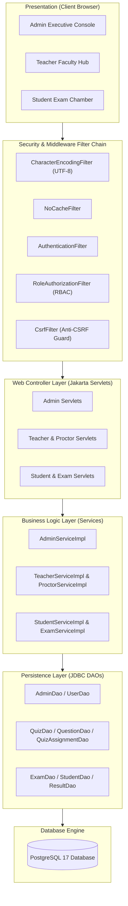
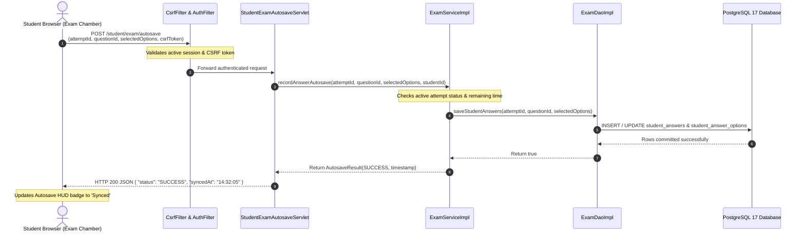

# QuizTrack — Online Examination & Assessment Platform

[](https://www.oracle.com/java/)
[](https://jakarta.ee/)
[](https://tomcat.apache.org/)
[](https://www.postgresql.org/)
[](https://maven.apache.org/)
[](https://junit.org/junit5/)

QuizTrack is a production-ready, full-stack online examination and proctoring web platform developed in Java 21 and Jakarta EE 10 (Servlet 6.0, JSP 3.1) running on Apache Tomcat 10.1+ with PostgreSQL 17.

> **Official Project Report:** The comprehensive academic report for academic evaluation is available in [`PROJECT_REPORT.md`](PROJECT_REPORT.md).

---

## 1. Project Introduction & Problem Statement

### Problem Statement Heading
> **Secure Automated Online Examination And Proctoring Platform**

*(Strictly 7 words)*

### Description
In traditional academic testing, institutions face significant operational and integrity risks:
- **Academic Dishonesty:** Examinees switch tabs, consult external resources, or minimize windows without invigilator detection.
- **Manual Overhead:** Paper authoring, printing, physical proctoring, and handwritten grading delay evaluation by days or weeks.
- **Progress Loss on Interruption:** Many web exam systems submit answers only at the very end; a browser crash or network drop erases all answers.
- **Fragmented Systems:** Lack of unified role management between administrators, instructors, and examinees leads to disjointed workflows.

**QuizTrack Solution:**  
QuizTrack establishes a unified institutional platform providing:
1. **Fullscreen Proctoring Lockdown:** Client-side Fullscreen API enforcement with real-time blur/tab-switch tripwires that record security strikes and stream telemetry to faculty.
2. **Asynchronous Background Autosave:** Every answer selection is instantly persisted to PostgreSQL via background AJAX requests (`/student/exam/autosave`), ensuring zero progress loss.
3. **Role-Based Governance (Admin, Teacher, Student):** Clear role segregation with CSRF protection, secure sessions, and tailored operational consoles.
4. **Interactive Quiz Creation & Item Banking:** Multi-step wizard supporting Single Choice, Multi-Correct (with proportional credit), and True/False questions with reusable question banks.

---

## 2. Project Modules

```
                              ┌──────────────────────────────────┐
                              │            QuizTrack             │
                              │     Institutional Gateway        │
                              └─────────────────┬────────────────┘
                                                │
         ┌──────────────────────────────┬───────┴──────────────────────┬──────────────────────────────┐
         ▼                              ▼                              ▼                              ▼
┌──────────────────┐           ┌──────────────────┐           ┌──────────────────┐           ┌──────────────────┐
│  Authentication  │           │   Admin Module   │           │  Teacher Module  │           │  Student Module  │
│  & CSRF Security │           │(Executive Hub)   │           │(Faculty Studio)  │           │ (Candidate Hub)  │
└──────────────────┘           └──────────────────┘           └──────────────────┘           └──────────────────┘
```

1. **Admin Module (Executive Hub):**
   - Executive dashboard with global KPIs (users, quizzes, active sessions, pass rates).
   - Department management with faculty rosters, authored exam metrics, and top student performers.
   - User account directory (search, role filtering, status toggles, password resets).
   - System configuration and audit logging.
2. **Teacher Module (Faculty Studio):**
   - Academic overview dashboard with active examination countdown timers and completion averages.
   - Step-by-step quiz creation wizard with scheduling window validation.
   - Dynamic question builder supporting MCQ, Multi-Correct (with partial credit), and True/False items.
   - Question bank reuse via `quiz_questions` join table.
   - Department-scoped cohort assignment matrix.
   - Live proctoring HUD with telemetry violation alerts.
3. **Student Module (Candidate Hub):**
   - Candidate academic dashboard with assigned quiz cards and hardware pre-flight checks.
   - Fullscreen-locked examination chamber with timer countdown and question palette.
   - Asynchronous option autosave.
   - Instant scorecard, review breakdown, and verified completion certificates.

---

## 3. Project Architecture & Request Flow

### 3.1 Layered Architecture


### 3.2 Single API Call Flow: Examinee Answer Autosave


---

## 4. Top 5 Features & Source Code

We focus on the 5 core features across the system:
1. **Admin Executive Dashboard & Department Management**
2. **Teacher Academic Overview Dashboard**
3. **Student Academic Dashboard**
4. **Live Exam Engine with Fullscreen Proctoring Lockdown**
5. **Teacher Quiz Creation & Question Builder Flow**

---

### Feature 1: Admin Executive Dashboard
* **Primary Code:** `src/main/java/com/quiztrack/dao/impl/AdminDaoImpl.java` & `src/main/java/com/quiztrack/service/impl/AdminServiceImpl.java`
* **UI View:** `src/main/webapp/WEB-INF/views/admin/dashboard.jsp`
* **Screenshot:** `docs/screenshots/01_admin_dashboard.jpg`

```java
// AdminDaoImpl.java - Executive Metrics Aggregation
public AdminDashboardStats getDashboardStatistics() {
    AdminDashboardStats stats = new AdminDashboardStats();
    String statsSql = 
        "SELECT " +
        "  (SELECT COUNT(*) FROM users WHERE role_id = (SELECT role_id FROM roles WHERE role_name = 'STUDENT')) AS student_count, " +
        "  (SELECT COUNT(*) FROM users WHERE role_id = (SELECT role_id FROM roles WHERE role_name = 'TEACHER')) AS teacher_count, " +
        "  (SELECT COUNT(*) FROM users WHERE role_id = (SELECT role_id FROM roles WHERE role_name = 'ADMIN')) AS admin_count, " +
        "  (SELECT COUNT(*) FROM quizzes) AS total_quizzes, " +
        "  (SELECT COUNT(*) FROM quizzes WHERE status = 'ACTIVE') AS active_exams, " +
        "  (SELECT COUNT(*) FROM quiz_attempts WHERE status = 'SUBMITTED') AS completed_attempts, " +
        "  (SELECT COALESCE(AVG(percentage), 0.0) FROM quiz_attempts WHERE status = 'SUBMITTED') AS avg_score, " +
        "  (SELECT COALESCE((COUNT(CASE WHEN passed = TRUE THEN 1 END) * 100.0 / NULLIF(COUNT(*), 0)), 0.0) " +
        "   FROM quiz_attempts WHERE status = 'SUBMITTED') AS pass_rate";

    try (Connection conn = DatabaseConnection.getConnection();
         PreparedStatement ps = conn.prepareStatement(statsSql);
         ResultSet rs = ps.executeQuery()) {
        if (rs.next()) {
            stats.setTotalStudents(rs.getInt("student_count"));
            stats.setTotalTeachers(rs.getInt("teacher_count"));
            stats.setTotalAdmins(rs.getInt("admin_count"));
            stats.setTotalQuizzes(rs.getInt("total_quizzes"));
            stats.setActiveExaminations(rs.getInt("active_exams"));
            stats.setCompletedAttempts(rs.getInt("completed_attempts"));
            stats.setAverageScorePercentage(Math.round(rs.getDouble("avg_score") * 100.0) / 100.0);
            stats.setOverallPassRate(Math.round(rs.getDouble("pass_rate") * 100.0) / 100.0);
        }
    } catch (SQLException e) {
        logger.error("Error retrieving admin dashboard metrics", e);
    }
    return stats;
}
```

---

### Feature 2: Teacher Academic Overview Dashboard
* **Primary Code:** `src/main/java/com/quiztrack/service/impl/TeacherServiceImpl.java` & `src/main/java/com/quiztrack/controller/teacher/TeacherDashboardServlet.java`
* **UI View:** `src/main/webapp/WEB-INF/views/teacher/dashboard.jsp`
* **Screenshot:** `docs/screenshots/02_teacher_dashboard.jpg`

```java
// TeacherServiceImpl.java - Truthful Active Exam Banner & Remaining Timer
@Override
public TeacherDashboardData getDashboardOverview(int teacherId, boolean isAdmin) {
    TeacherDashboardData data = new TeacherDashboardData();
    data.setActiveQuizzesCount(isAdmin ? quizDao.countQuizzesByStatus("ACTIVE") 
                                       : quizDao.countQuizzesByStatusAndTeacher("ACTIVE", teacherId));
    data.setScheduledQuizzesCount(isAdmin ? quizDao.countQuizzesByStatus("SCHEDULED") 
                                           : quizDao.countQuizzesByStatusAndTeacher("SCHEDULED", teacherId));
    data.setCompletedSessionsCount(analyticsDao.countTotalCompletedSessions());
    data.setAverageClassScore(analyticsDao.calculateAverageClassScore());
    data.setProctorTrustIndex(analyticsDao.getProctorTrustIndex());

    Optional<Quiz> activeQuizOpt = isAdmin ? quizDao.findActiveQuiz() 
                                           : quizDao.findActiveQuizByTeacher(teacherId);
    if (activeQuizOpt.isPresent()) {
        Quiz activeQuiz = activeQuizOpt.get();
        data.setActiveQuiz(activeQuiz);
        int examinees = analyticsDao.countActiveExaminees(activeQuiz.getQuizId());
        int totalAssigned = analyticsDao.countTotalAssignedStudents(activeQuiz.getQuizId());
        data.setActiveExaminees(examinees);
        data.setTotalAssignedExaminees(totalAssigned);
        
        int connectedPct = (totalAssigned > 0) ? (int) Math.round(((double) examinees / totalAssigned) * 100.0) : 0;
        data.setConnectedPercentage(Math.min(100, Math.max(0, connectedPct)));
        
        if (activeQuiz.getEndTime() != null) {
            long remainingMillis = activeQuiz.getEndTime().getTime() - System.currentTimeMillis();
            if (remainingMillis > 0) {
                long totalMinutes = remainingMillis / (60 * 1000);
                data.setRemainingTime(String.format("%02dh %02dm remaining", totalMinutes / 60, totalMinutes % 60));
            }
        }
    }
    return data;
}
```

---

### Feature 3: Student Academic Dashboard
* **Primary Code:** `src/main/java/com/quiztrack/service/impl/StudentServiceImpl.java` & `src/main/java/com/quiztrack/controller/student/StudentDashboardServlet.java`
* **UI View:** `src/main/webapp/WEB-INF/views/student/dashboard.jsp`
* **Screenshot:** `docs/screenshots/03_student_dashboard.jpg`

```java
// StudentServiceImpl.java - Assigned Quiz Discovery & Candidate KPIs
@Override
public StudentDashboardData getStudentDashboardData(int studentId) {
    StudentDashboardData data = new StudentDashboardData();

    // 1. Student Profile & Cohort Scoping
    Optional<User> userOpt = userDao.findById(studentId);
    userOpt.ifPresent(u -> {
        data.setStudent(u);
        if (u.getCohort() != null && !u.getCohort().isEmpty()) {
            data.setCohortCode("COHORT " + u.getCohort());
        }
    });

    // 2. Discover Eligible Assigned Quizzes
    List<StudentQuizCard> assignedQuizzes = studentDao.getAssignedQuizzes(studentId);
    data.setAssignedQuizzes(assignedQuizzes);

    // 3. Prioritize Active Assessment for In-Flight Banner
    for (StudentQuizCard card : assignedQuizzes) {
        if ("ACTIVE".equalsIgnoreCase(card.getStatus()) && !"SUBMITTED".equalsIgnoreCase(card.getAttemptStatus())) {
            quizDao.findById(card.getQuizId()).ifPresent(data::setActiveQuiz);
            break;
        }
    }

    // 4. Calculate Diagnostic KPIs (Attempts, Standing, GPA, Integrity Index)
    studentDao.populateStudentKPIs(studentId, data);
    return data;
}
```

---

### Feature 4: Live Exam Engine with Fullscreen Proctoring Lockdown
* **Primary Code:** `src/main/webapp/WEB-INF/views/student/exam-engine.jsp` & `src/main/java/com/quiztrack/controller/student/StudentExamAutosaveServlet.java`
* **Screenshot:** `docs/screenshots/04_exam_fullscreen_mode.jpg`

```javascript
// exam-engine.jsp - Fullscreen Lock and Exit Violation Listener
function triggerFullscreenLockdown() {
    const docEl = document.documentElement;
    const req = docEl.requestFullscreen || docEl.webkitRequestFullscreen || docEl.mozRequestFullScreen;
    if (req) {
        req.call(docEl).then(() => {
            document.getElementById('fullscreen-gate-modal').classList.add('hidden');
        }).catch(err => {
            alert("Fullscreen mode is mandatory to access this examination chamber.");
        });
    }
}

document.addEventListener('fullscreenchange', function() {
    if (!document.fullscreenElement) {
        // Log telemetry strike when examinee exits fullscreen
        logProctorViolation('FULLSCREEN_EXIT', 'Candidate minimized or exited fullscreen exam chamber.');
        document.getElementById('fullscreen-gate-modal').classList.remove('hidden');
    }
});

// Asynchronous Autosave on Option Click
function triggerAutosave(qIndex) {
    const selectedOptions = getSelectedOptionValues(qIndex);
    const payload = new URLSearchParams({
        csrfToken: EXAM_CONTEXT.csrfToken,
        attemptId: EXAM_CONTEXT.attemptId,
        questionId: questions[qIndex].questionId,
        selectedOptions: selectedOptions.join(',')
    });

    fetch(EXAM_CONTEXT.contextPath + '/student/exam/autosave', {
        method: 'POST',
        headers: { 'Content-Type': 'application/x-www-form-urlencoded' },
        body: payload
    }).then(r => r.json()).then(res => {
        if (res.status === 'SUCCESS') {
            document.getElementById('autosave-time').innerText = new Date().toLocaleTimeString();
        }
    });
}
```

```java
// StudentExamAutosaveServlet.java - Server-Side Answer Persistence
@Override
protected void doPost(HttpServletRequest request, HttpServletResponse response) 
        throws ServletException, IOException {
    response.setContentType("application/json");
    int attemptId = Integer.parseInt(request.getParameter("attemptId"));
    int questionId = Integer.parseInt(request.getParameter("questionId"));
    String[] optionIds = request.getParameterValues("selectedOptions");
    int studentId = (Integer) request.getSession().getAttribute("userId");

    boolean saved = examService.recordAnswerAutosave(attemptId, questionId, optionIds, studentId);
    JsonObject json = new JsonObject();
    json.addProperty("status", saved ? "SUCCESS" : "ERROR");
    json.addProperty("timestamp", System.currentTimeMillis());
    response.getWriter().write(json.toString());
}
```

---

### Feature 5: Teacher Quiz Creation & Question Builder Flow
* **Primary Code:** `src/main/java/com/quiztrack/controller/teacher/TeacherQuizCreateServlet.java` & `src/main/java/com/quiztrack/service/impl/TeacherServiceImpl.java`
* **UI View:** `src/main/webapp/WEB-INF/views/teacher/quiz-create.jsp`
* **Screenshot:** `docs/screenshots/05_teacher_quiz_creation.jpg`

```java
// TeacherQuizCreateServlet.java - Quiz Validation & Persistence
protected void doPost(HttpServletRequest request, HttpServletResponse response) 
        throws ServletException, IOException {
    int teacherId = (Integer) request.getSession().getAttribute("userId");
    String title = request.getParameter("title");
    int subjectId = Integer.parseInt(request.getParameter("subjectId"));
    int durationMinutes = Integer.parseInt(request.getParameter("durationMinutes"));
    String startTimeStr = request.getParameter("startTime");
    String endTimeStr = request.getParameter("endTime");

    // Validate title, duration boundaries, and valid scheduling window
    teacherService.validateQuizParameters(title, durationMinutes, startTimeStr, endTimeStr);

    Quiz quiz = new Quiz();
    quiz.setTitle(title.trim());
    quiz.setTeacherId(teacherId);
    quiz.setSubjectId(subjectId);
    quiz.setDurationMinutes(durationMinutes);
    quiz.setStartTime(parseTimestamp(startTimeStr));
    quiz.setEndTime(parseTimestamp(endTimeStr));
    quiz.setStatus("DRAFT");

    int quizId = teacherService.createQuiz(quiz);
    response.sendRedirect(request.getContextPath() + "/teacher/quiz/builder?quizId=" + quizId);
}
```

---

## 5. Output Screenshots & Reproduction Guide

All screenshots are stored in the [`docs/screenshots/`](docs/screenshots/) folder:

```
docs/screenshots/
├── 01_admin_dashboard.jpg         # Feature 1: Admin Executive System Console
├── 02_teacher_dashboard.jpg       # Feature 2: Teacher Academic Overview & Live Session
├── 03_student_dashboard.jpg       # Feature 3: Student Portal Dashboard & Assessments
├── 04_exam_engine.png             # Feature 4: Live Exam Engine & Question Palette
├── 05_teacher_quiz_creation.jpg   # Feature 5: Teacher Quiz Builder & Question Drafting
├── 06_code_admin_dao.jpg          # Code Capture: AdminDaoImpl.java in VS Code
└── 07_code_teacher_service.jpg    # Code Capture: TeacherServiceImpl.java in VS Code
```

### Navigation Steps to View & Capture Each Feature:

| Feature | Screenshot File | Browser URL / Path | Steps to Trigger in UI |
|---|---|---|---|
| **1. Admin Dashboard** | `docs/screenshots/01_admin_dashboard.jpg` | `http://localhost:8080/quiztrack/auth/demo?role=admin` | Automatically redirects to `/admin/dashboard`. Displays system KPI cards (35 Students, 4 Teachers, 8 Quizzes), performance charts, and audit activity. |
| **2. Teacher Dashboard** | `docs/screenshots/02_teacher_dashboard.jpg` | `http://localhost:8080/quiztrack/auth/demo?role=teacher` | Opens `/teacher/dashboard`. Displays the live CS402 exam banner, 42/6 connected examinees, review alerts, and 5 KPI cards. |
| **3. Student Dashboard** | `docs/screenshots/03_student_dashboard.jpg` | `http://localhost:8080/quiztrack/auth/demo?role=student` | Redirects to `/student/dashboard`. Shows "Welcome back, Alex!", live exam admission countdown, and Hardware Pre-Flight checks. |
| **4. Live Exam Engine** | `docs/screenshots/04_exam_engine.png` | `http://localhost:8080/quiztrack/auth/demo?role=student` | On the active quiz card, click **Start Assessment**. Displays question prompt, option choices, timer, and Question Palette. |
| **5. Question Builder** | `docs/screenshots/05_teacher_quiz_creation.jpg` | `http://localhost:8080/quiztrack/auth/demo?role=teacher` | In sidebar, open `/teacher/quiz/builder?quizId=...`. Displays question type pills, formula toolbar, and dynamic option choices. |
| **6. Admin DAO Code** | `docs/screenshots/06_code_admin_dao.jpg` | Open VS Code at `AdminDaoImpl.java` | Displays `getDashboardStatistics()` aggregating database metrics in `com.quiztrack.dao.impl`. |
| **7. Teacher Service Code** | `docs/screenshots/07_code_teacher_service.jpg` | Open VS Code at `TeacherServiceImpl.java` | Displays constructors and DAO dependency injection in `com.quiztrack.service.impl`. |

---

## 6. Project Directory Map (Code Files Location)

Use this quick-reference guide to locate the files in your IDE:

```
QuizTrack/
├── src/main/java/com/quiztrack/
│   ├── controller/
│   │   ├── admin/AdminDashboardServlet.java          # Feature 1
│   │   ├── teacher/TeacherDashboardServlet.java      # Feature 2
│   │   ├── teacher/TeacherQuizCreateServlet.java     # Feature 5
│   │   ├── student/StudentDashboardServlet.java      # Feature 3
│   │   ├── student/StudentExamServlet.java           # Feature 4
│   │   └── student/StudentExamAutosaveServlet.java   # Feature 4
│   ├── service/impl/
│   │   ├── AdminServiceImpl.java                     # Feature 1
│   │   ├── TeacherServiceImpl.java                   # Features 2 & 5
│   │   ├── StudentServiceImpl.java                   # Feature 3
│   │   └── ExamServiceImpl.java                      # Feature 4
│   └── dao/impl/
│       ├── AdminDaoImpl.java                         # Feature 1
│       ├── QuizDaoImpl.java                          # Features 2 & 5
│       ├── QuestionDaoImpl.java                      # Feature 5
│       └── ExamDaoImpl.java                          # Feature 4
└── src/main/webapp/WEB-INF/views/
    ├── admin/dashboard.jsp                           # Feature 1
    ├── teacher/dashboard.jsp                         # Feature 2
    ├── teacher/quiz-create.jsp                       # Feature 5
    ├── student/dashboard.jsp                         # Feature 3
    └── student/exam-engine.jsp                       # Feature 4
```

---

## 7. Setup & Execution Guide

### Prerequisites
- **Java Development Kit (JDK):** Version 21 (LTS) or higher
- **Apache Maven:** Version 3.9+
- **PostgreSQL Database:** Version 15, 16, or 17
- **Web Application Server:** **Apache Tomcat 10.1+** (*Tomcat 9 is incompatible with Jakarta EE 10*)

### Step 1: Database Setup
```bash
createdb -U postgres quiztrack_db
psql -U postgres -d quiztrack_db -f database/schema.sql
psql -U postgres -d quiztrack_db -f database/seed_data.sql
```

### Step 2: Configure Database Credentials
Edit `src/main/resources/db.properties` or set environment variables:
```bash
# Windows PowerShell
$env:QUIZTRACK_DB_URL="jdbc:postgresql://localhost:5432/quiztrack_db"
$env:QUIZTRACK_DB_USER="postgres"
$env:QUIZTRACK_DB_PASSWORD="your_postgres_password"
```

### Step 3: Build & Package
```bash
mvn clean package
```
Build output: `target/quiztrack.war`

### Step 4: Deploy to Tomcat 10.1+
Copy `target/quiztrack.war` to `<TOMCAT_HOME>/webapps/quiztrack.war` and start Tomcat:
```bash
# Windows
<TOMCAT_HOME>\bin\catalina.bat run
```
Access the application: [http://localhost:8080/quiztrack/](http://localhost:8080/quiztrack/)

---

## 8. Demo User Accounts

All seeded accounts use password: **`password123`**

| Role | Username | One-Click Demo Login Link |
|---|---|---|
| **ADMIN** | `admin` | [http://localhost:8080/quiztrack/auth/demo?role=admin](http://localhost:8080/quiztrack/auth/demo?role=admin) |
| **TEACHER** | `ronald.vance` | [http://localhost:8080/quiztrack/auth/demo?role=teacher](http://localhost:8080/quiztrack/auth/demo?role=teacher) |
| **STUDENT** | `CS-2022-041` | [http://localhost:8080/quiztrack/auth/demo?role=student](http://localhost:8080/quiztrack/auth/demo?role=student) |

---

## 9. Running Automated Tests

Run all 140 JUnit 5 integration and unit tests:
```bash
mvn test
```
**Test Results:** `140 Tests Run, 0 Failures, 0 Errors, 0 Skipped (100% Green)`
